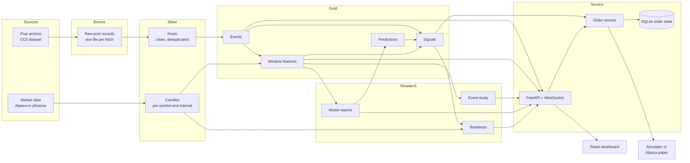
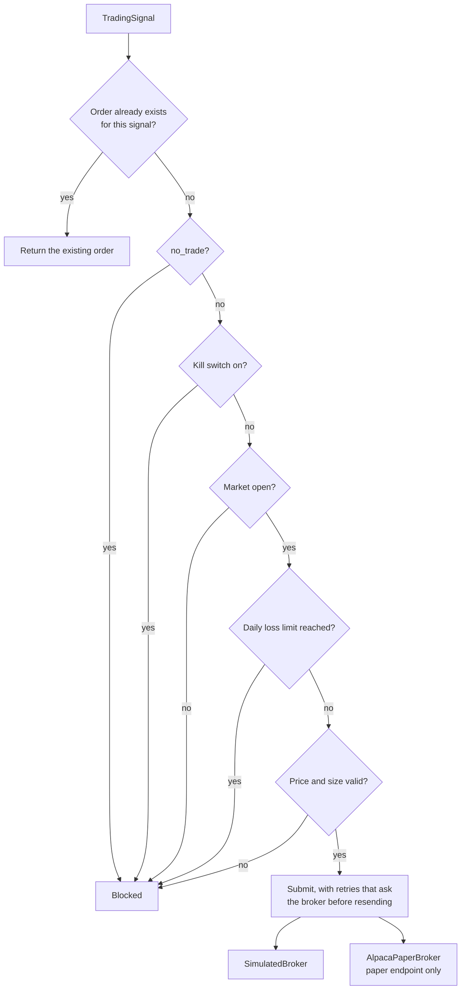

# Architecture

## Overview

TradeBot is a local-first pipeline with a thin service layer on top. Data moves in one
direction through three storage layers; every module exchanges data only through the shared
contracts in `src/contracts`.

## Modules and ownership

| Module | Owner | Responsibility | Depends on |
|--------|-------|----------------|-----------|
| `src/contracts` | A0 Architecture | The shared models and enumerations | nothing |
| `src/core` | A0 Architecture | Settings, logging, time rules, storage paths and Parquet helpers | contracts |
| `src/ingestion` | A1 Data | Post sources, HTTP with retries, normalisation, Bronze writer | core |
| `src/pipelines` | A1 Data | Orchestration: posts, events, features, market, live cycle | all domain modules |
| `src/market_data` | A2 Market data | Providers, NYSE calendar, universe, candle store, event windows | core |
| `src/ml` | A3 ML | Classifier, entity recognition, dataset splits, baseline model, inference | core, universe |
| `src/strategies` | A4 Research | Strategies A, B, C | contracts |
| `src/backtesting` | A4 Research | Event study, engine, metrics, runner | market_data, strategies |
| `src/trading` | A5 Backend | `ExecutionBroker`, simulator, paper adapter, order service, state | calendar |
| `src/api` | A5 Backend | FastAPI routes, services container, live stream | everything above |
| `frontend` | A6 Frontend | Dashboard | the HTTP API only |
| `tests`, `infra`, `.github` | A7 QA | Tests, containers, CI | everything |

Rules:

- A module imports another module's published interface, never its internals.
- A contract change is recorded in `docs/API_CONTRACTS.md` and `docs/DECISIONS.md` in the
  same change. `tests/contract` fails if the OpenAPI schema or the TypeScript types drift.
- Business logic stays out of HTTP handlers and CLI commands; both call the same functions.

## Storage

| Layer | Path under `data/` | Content | Rebuilt from |
|-------|--------------------|---------|--------------|
| Bronze | `bronze/posts/<source>/<fetch>.parquet` | Raw records exactly as fetched, with fetch metadata | the source |
| Silver | `silver/posts.parquet`, `silver/post_rejections.parquet` | Clean posts; rejected records with reasons | Bronze |
| Silver | `silver/candles/<interval>/<symbol>.parquet` | Candles with source and quality label | the provider |
| Gold | `gold/events.parquet` | Market events | Silver posts |
| Gold | `gold/features.parquet` | Window measurements | events and candles |
| Gold | `gold/predictions.parquet`, `gold/signals.parquet` | Out-of-sample predictions; latest signals | models and strategies |
| Reports | `reports/{event_study,models,backtests}/*.json` | Research outputs | Gold |
| Models | `models/<name>/<version>/` | Fitted model and its report | Gold |
| State | `state/orders.sqlite` | Paper orders, kill switch, daily equity | order service |

Every layer except Bronze and State can be deleted and rebuilt. The whole `data/` directory
is ignored by Git.

## Point-in-time rules

These rules are what make the research honest. They live in one place each.

| Rule | Where |
|------|-------|
| A live post is available when it was collected. A backfilled post is assumed available `assumed_latency` after publication | `src/core/timeutils.py::availability_time` |
| Every measurement is anchored at availability plus `decision_latency` | `src/pipelines/features.py` |
| A tradable window is entered at the first bar at or after its anchor; a contract validator rejects an earlier entry | `src/market_data/windows.py`, `src/contracts/market.py` |
| Missing bars make a window unavailable. Nothing is interpolated | `src/market_data/windows.py` |
| Model inputs use the anchor post only. Splits are chronological and purged | `src/ml/dataset.py` |
| Strategy A trades only on walk-forward (out-of-sample) predictions | `src/ml/baseline.py`, `src/backtesting/runner.py` |
| Strategies B and C decide when their trigger window ends, not before | `src/strategies/*.py` |
| A backtest trade cannot be entered before its signal; a contract validator enforces it | `src/contracts/trading.py` |

## Event windows

- **Intraday (5m to 4h)**: enter at the open of the first regular-session bar at or after
  the anchor, exit at the close of the last bar inside the window. Unavailable if bars are
  missing, coarser than the window, or the window crosses the close.
- **Next trading day (`1d`)**: enter at the open of the first session opening at or after
  the anchor, exit at that session's close.
- **`close_to_close`**: last close before the anchor to the first close after it.
  Descriptive only, marked not tradable.
- **Abnormal return**: symbol return minus SPY return over the same window.

## Paper-trading safety boundary

- `ExecutionBroker` has two implementations. A live one does not exist.
- `AlpacaPaperBroker` raises `LiveTradingForbidden` for any base URL other than
  `https://paper-api.alpaca.markets`. The URL is a constant, not a setting.
- `Settings` has no trading URL and no live flag. A test asserts this, and another asserts
  that no source file names Alpaca's live host.
- The signal ID is the order's unique key in SQLite, so a signal can become at most one order,
  across retries and restarts.

## Live processing

`src/pipelines/live.py::run_live_cycle` fetches a source, rebuilds events, and for each new
event produces predictions, a Strategy A signal, and (if allowed) a paper order, publishing
each step on the WebSocket stream. Events from backfilled posts, and events published more
than 30 minutes ago, are recorded but never traded.

## Technology

Python 3.12, Pydantic v2, Polars and Parquet, httpx, FastAPI, Typer, scikit-learn,
exchange-calendars; React 18, TypeScript, Vite, Tailwind CSS, Recharts; pytest, ruff, mypy,
Vitest; GitHub Actions; Docker Compose.
